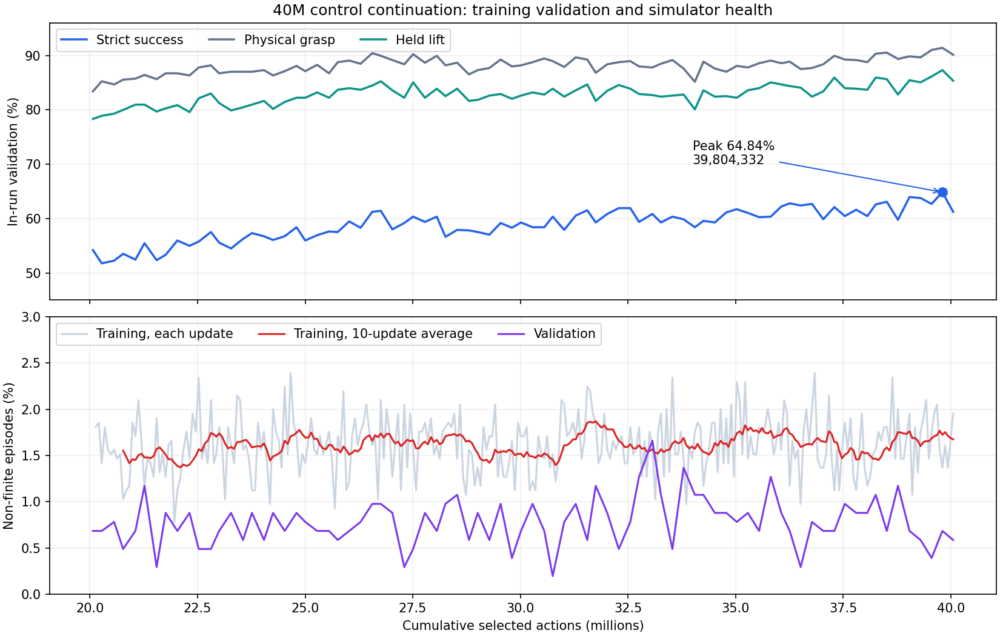

# 40M control continuation: matched evaluation and endpoint promotion

**Current decision:** promote final `step_40056193` for development; resume
unchanged to 60M total selected actions. The matched evidence and resume command
are below; the earlier evaluation handoff is retained as history.

Reviewed 2026-10-19. The user identifies the completed run as
`latent_control_to40m_20261012_230538`, with endpoint
`rl/step_40056193/smolvla_grpo_adapter.pt`. Unlike the earlier console paste,
this event file contains the 20M → 40M continuation.

## Evidence and training outcome

[Source hash and summary](../../artifacts/latent_control_40m_20261019/summary.json),
[81 validation readings](../../artifacts/latent_control_40m_20261019/validation.csv),
and [299 update readings](../../artifacts/latent_control_40m_20261019/training.csv)
are retained. Scalar sampling was disabled when reading the event file.
Steps are exact integer Event.step metadata; the final selected-action scalar
rounds to 40,056,192, so it must not be used as the checkpoint name.

Training advances **20,068,312 → 40,056,193**, adding **19,987,881 selected
actions**, 299 updates (560 cumulative), 609,792 episodes and 141,277 optimizer
steps. Recorded training elapsed time is **89.14 hours**. Cumulative pilot
work timers have a different scope and are not used for that elapsed figure.
No launch provenance or checkpoint bytes were supplied; the run directory
comes from the user and checkpoint hashes remain to be captured by evaluation.

| In-run validation, 1024 episodes | Resume 20,068,312 | Peak 39,804,332 | Final 40,056,193 |
|---|---:|---:|---:|
| Strict successes | 555 | 664 | 627 |
| Strict rate | 54.20% | 64.84% | 61.23% |
| Physical grasp | 83.40% | 91.41% | 90.14% |
| Held lift | 78.32% | 87.30% | 85.35% |
| Plate strict | 60.35% | 72.66% | 70.90% |
| Bowl strict | 48.05% | 57.03% | 51.56% |
| Carry slip | 23.54% | 21.78% | 23.63% |
| Wrong place | 21.58% | 18.46% | 19.04% |
| Non-finite episodes | 0.68% | 0.68% | 0.59% |

Endpoint strict gains **7.03 pp** versus this invocation's initial validation.
The first 20 validation readings average 55.05%, the final 20 average 61.91%.
These correlated panel averages describe the trend, not independent statistical
replication. The initial 54.20% differs from the prior run's 53.03% endpoint
reading of the same 20M checkpoint; stochastic closed-loop evaluations vary.
Do not compare 61.23% directly against the earlier off-panel 53.47% as a
matched gain. No 40M off-panel result has yet been supplied.



## Optimization and health

All 299 recorded policy-loss, entropy, KL, PPO clipping, mean-gradient, log-std,
LR and LoRA-change readings are finite with full update coverage. LR remains
1e-5 and LoRA change zero. KL median 0.002942, maximum 0.021169; PPO clipping
ranges 1.247–1.960%; gradient means 4.093–5.659. No recorded optimization
collapse is evident. This does not prove every intermediate tensor was finite.

Mean reported non-finite episode rate is **1.619%**, close to the prior leg's
1.622%. First/last 20 update means are 1.523% / 1.665%, with no large late
escalation visible. The aggregate episode count gives
**9,881/609,792 = 1.620%**. Five updates contain 1,536 episodes rather than
2,048; their steps are retained in summary.json. The logged rate is a mean
across ranks, whereas episode counts are summed, so multiplying every rate
by a fixed 2,048 would give an incorrect failure count. The global count and
episode total are used for the aggregate health rate.

Both pad-force streams contain only 228 of 299 readings. The writer skips
non-finite scalars, so the 71 missing readings are unavailable contact-force
diagnostics, not evidence of finite forces. The raw JSONL can clarify them.

## Initial evaluation handoff (completed)

Continuing the existing parameters was productive on the training validation
panel. There is no demonstrated reason to switch architecture, rewards or LR
now. **Next perform a checkpoint comparison, not another training pilot.**
Use the promoted 20M control as baseline, final40m as the primary endpoint,
and peak39m as a secondary panel-selected candidate:

| Role | Directory relative to the server repository |
|---|---|
| Promoted baseline | `runs/latent_control_long_20261009_160735/rl/step_20068312` |
| Primary endpoint | `runs/latent_control_to40m_20261012_230538/rl/step_40056193` |
| Panel-selected alternative | `runs/latent_control_to40m_20261012_230538/rl/step_39804332` |

Each must contain `smolvla_grpo_adapter.pt`. The final checkpoint path was
supplied by the user; peak existence is expected from validation checkpointing
but has not been inspected on the server. The launcher checks file existence.
The peak has 37 more panel successes than final (3.61 pp), but it was selected
from 81 readings. That does not establish an off-panel advantage or a collapse
at the final checkpoint. Both deserve comparison; retain both.

The same 512 off-panel development scenes × four repeats × three checkpoints
requires 6,144 episodes. The second command compares peak versus final on CPU
from those saved episodes, with no additional simulation. Keep final_test
untouched. Continue to use the 3 pp grasp/lift retention criterion and inspect
non-finite outcomes. Until these results arrive, 20M remains the promoted
checkpoint; 40M is a completed training result awaiting comparison.

```bash
cd /root/repo/RL_VLA_Bootstrapping
git pull --ff-only
unset SCENE_LIST SCENE_CLASS CONTROLLER_Z_MAX STOCHASTIC_SEED
BASE=runs/latent_control_long_20261009_160735/rl/step_20068312
LONG=runs/latent_control_to40m_20261012_230538/rl
OUT="runs/latent_control_40m_comparison_$(date +%Y%m%d_%H%M%S)"

CHECKPOINTS="control20m=$BASE final40m=$LONG/step_40056193 peak39m=$LONG/step_39804332" \
  OUT_ROOT="$OUT" REPEATS=4 GPUS="0 1" WORLDS=64 ROUNDS=8 \
  CONFIG=configs/examples/cdpr_smolvla_three_stage_put_into.yaml \
  SCENES=runs/three_stage/scenes_8192.json SPLIT=student_validation \
  SCENE_MANIFEST=runs/three_stage/scenes_8192.json RETENTION_MARGIN=0.03 \
  DECISIONS=128 SETTLE_DECISIONS=0 PRIOR_NOISE_SCALE=1 EXCLUDE_VALIDATION_PANEL=1 \
  bash scripts/compare_cdpr_three_stage_repeats_remote.sh &&
conda run --no-capture-output -n cdpr-mjlab python3 tools/audit/compare_put_into_repeats.py \
  --checkpoint "final40m=$OUT/final40m/rep1,$OUT/final40m/rep2,$OUT/final40m/rep3,$OUT/final40m/rep4" \
  --checkpoint "peak39m=$OUT/peak39m/rep1,$OUT/peak39m/rep2,$OUT/peak39m/rep3,$OUT/peak39m/rep4" \
  --retention-margin 0.03 --scene-manifest runs/three_stage/scenes_8192.json \
  --output "$OUT/peak_vs_final.json"
```

Return `comparison.json` and `peak_vs_final.json` from `$OUT`; no model upload
is needed. Reuse the same OUT when resuming an interrupted evaluation. If both
beat 20M and peak has no demonstrated advantage, prefer the primary final
endpoint. A clear peak advantage must also retain grasp/lift and acceptable
simulator health. If promotion passes, another substantial continuation with
the same parameters is reasonable; choose its source and budget after this
comparison. No remote training or evaluation was run locally.

## Matched evaluation: promote final40m

Received reports from `latent_control_40m_comparison_20261019_152358`:
[comparison.json](../../artifacts/latent_control_40m_comparison_20261019/comparison.json)
and [peak_vs_final.json](../../artifacts/latent_control_40m_comparison_20261019/peak_vs_final.json).
Protocol, checkpoint hashes and shared aggregates agree across both reports.
The 20M baseline hash agrees with the previously promoted adapter. These are
512 development scenes × four repeats / 2,048 episodes per checkpoint,
excluding the 128-scene training validation panel. The direct peak/final
comparison reuses these same episodes, not new independent evidence.

| Checkpoint | Strict successes | Strict | Grasp | Held lift | Non-finite |
|---|---:|---:|---:|---:|---:|
| control20m | 1056/2048 | 51.56% | 85.84% | 80.52% | 1.32% |
| final40m | 1258/2048 | 61.43% | 89.65% | 85.89% | 1.37% |
| peak39m | 1256/2048 | 61.33% | 89.65% | 86.57% | 1.76% |

**Final versus 20M: +9.86 pp strict**, paired 95% CI **[+7.37, +12.30] pp**,
Holm p=0.00010. The exact increase is 202 successes; differences are computed
before display rounding. All four repeats improve (+44, +28, +59, +71).
Grasp +3.81 pp, CI [+1.95, +5.71]; held lift +5.37 pp, CI [+3.27, +7.52].
Both pass the −3 pp retention margin. These are within-task grasp/lift metrics,
not evidence of retention across unrelated instruction families.

The peak also passes against 20M. However, peak minus final is **−0.10 pp**,
CI **[−2.05, +1.81]**, p=0.9598. The 37-success panel advantage does not
persist off-panel: peak has two fewer successes here. There is no demonstrated
reason to replace the primary final endpoint with the panel-selected peak;
this is not an equivalence test. The direct report's no-promotion decision
concerns peak over final, not final over the 20M baseline.

There is now evidence of better carry/placement execution as well as pickup:

- Carry slip: 28.32% → 23.83%, difference −4.49 pp, CI [−6.79, −2.25].
- Wrong placement: 25.00% → 19.63%, difference −5.37 pp, CI [−7.62, −3.17].
- Strict given held lift: 64.04% → 71.52% (descriptive ratio).
- Non-finite: 1.32% → 1.37%, difference +0.05 pp, CI [−0.73, +0.83], p=1.0.
  No detected increase; this does not establish equivalence or zero failures.

Secondary metric intervals are reported as supplied; Holm correction above
applies to the primary strict comparisons. Failure flags may overlap.
Plate strict is 68.58%, bowl 54.22%; both improve. The difficult Q4 target-y
quartile rises from 10.08% to 29.07% (+18.99 pp, CI [+14.34, +23.84]). Q1/Q2
strict intervals still include zero; do not claim significant improvement in
every quartile. Potato remains weakest at 46.11%. Subgroup intervals are
exploratory and not multiplicity-adjusted.

Use the contemporaneous 51.56% baseline for the paired gain, not the earlier
53.47% from separate repeats. These reused development scenes support model
selection, not untouched final-test performance or an isolated causal claim
about the likelihood repair.

## Next training: unchanged control to 60M total actions

Promoted adapter:
`runs/latent_control_to40m_20261012_230538/rl/step_40056193/smolvla_grpo_adapter.pt`.
SHA-256: `63aff785cc0202ecea2f9c1e713f58648f14a0695a593975fa3022b4f2505e91`.

The user prefers continuing current parameters, and the matched evidence
supports that direction. Keep bounded residual, latent conditional likelihood,
LR=1e-5, PPO epochs=1, frozen LoRA, rewards, horizon and world count unchanged.
No further pilot or method switch is indicated now. Recommend **60M total
selected actions**, adding **19,943,807** before full-rollout overshoot.
This is a proposed substantial budget, not a demonstrated optimum or a promise
of continued gains. At the last leg's throughput, allow roughly 89 training
hours plus startup; actual time may differ.

```bash
cd /root/repo/RL_VLA_Bootstrapping
git pull --ff-only && \
env -u LEGACY_INIT_CHECKPOINT -u WARMSTART_CHECKPOINT \
  ARM=control \
  RESUME_CHECKPOINT=runs/latent_control_to40m_20261012_230538/rl/step_40056193 \
  EXPECTED_SOURCE_SHA256=63aff785cc0202ecea2f9c1e713f58648f14a0695a593975fa3022b4f2505e91 \
  MAX_TRAIN_STEPS=60000000 MAX_UPDATES=0 \
  PPO_EPOCHS=1 LR_OVERRIDE=1e-5 PRIOR_NOISE_SCALE=1 \
  CONFIG=configs/examples/cdpr_smolvla_three_stage_put_into_latent_correction.yaml \
  SCENES=runs/three_stage/scenes_8192.json \
  CUDA_VISIBLE_DEVICES=0,1 WORLDS_PER_RANK=512 SMOLVLA_MICROBATCH_SIZE=256 \
  RUN_PREFLIGHT=1 DRY_RUN=0 RUN_LABEL=latent_control_to60m \
  bash scripts/train_cdpr_latent_correction_pilot_remote.sh
```

The expected hash belongs to the resumed 40M adapter. MAX_UPDATES=0 disables
the update cap; 60M is cumulative since latent-likelihood conversion, not 60M
additional and not the historical legacy counter. Preserve final40m as the
next comparison baseline and retain peak39m and earlier source checkpoints.
After completion return metrics.jsonl, validation.jsonl and the console
summary; compare the new endpoint against final40m before promoting it.
Leave final_test untouched during model selection. Reconsider the method if
matched improvement stalls, retention regresses or simulator health worsens
persistently. No remote job was launched locally; no training code changed.
