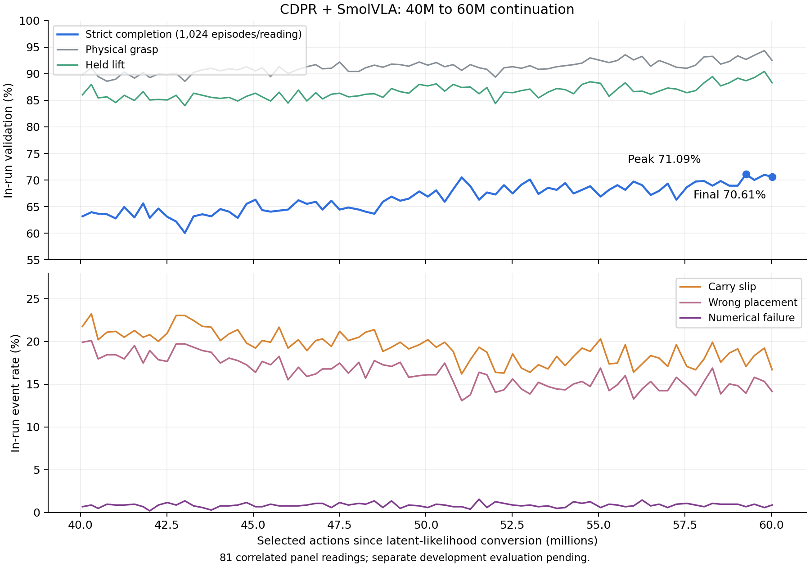

# 60M CDPR + SmolVLA continuation: TensorBoard results

Reviewed **2026-10-28**, Europe/Moscow. The supplied event file records
training and in-run validation on **October 19–23, 2026**. Separate validation
of the new endpoint is currently unavailable. This update reports the logged
measurements and does not promote a checkpoint.

## Evidence and measurement scope

Source: `events.out.tfevents.1792438865.VLAPU.666564.0`.
SHA-256: `7e22bff52be5d0da864e1df940b0aece07265436526f1aac0a6e7ae5cf0e8e73`.
The raw source remains the user-supplied file; extracted evidence is retained in
[summary.json](../../artifacts/latent_control_60m_20261028/summary.json),
[validation.csv](../../artifacts/latent_control_60m_20261028/validation.csv), and
[training.csv](../../artifacts/latent_control_60m_20261028/training.csv).
The [extraction script](../../artifacts/latent_control_60m_20261028/extract_metrics.py)
disables scalar sampling and checks count/rate and plate/bowl consistency for
every validation reading.

The counter advances **40,056,193 → 60,025,885**, adding **19,969,692 selected
actions** across **323 updates**, **655,872 training episodes** and **145,999
optimizer steps**. Recorded training elapsed time is **95.30 hours**. These
counters describe the continuation since latent-likelihood conversion; the
policy inherits the earlier training lineage and was not trained from scratch
in 60M actions. The resume step agrees with the previously promoted 40M
endpoint. LR remains 1e-5 and logged LoRA change remains zero.

The file contains **81 in-run validation readings**, each with **1,024
episodes**, including **512 plate and 512 bowl attempts**, with logged seed
2,000,000. The trainer aggregates actual episode counts across ranks: the
requested-episodes scalar is 256, not the measured denominator. Scene IDs,
the resolved launch configuration, run directory, checkpoint bytes and their
hashes are absent. Exact integer `Event.step` metadata identifies the readings;
the float32 `global_step` scalar rounds the endpoint to 60,025,884 and must
not be used as a checkpoint filename. The existence of checkpoint files at
the logged endpoint or peak has not been verified.

## Logged full-task results

| In-run validation | Resume 40,056,193 | Peak 59,268,127 | Endpoint 60,025,885 |
|---|---:|---:|---:|
| Strict success count / 1,024 | 647 | 728 | 723 |
| Strict success | 63.18% | **71.09%** | **70.61%** |
| Physical grasp | 89.84% | 92.68% | 92.48% |
| Held lift | 86.04% | 88.67% | 88.28% |
| Plate strict (512 attempts) | 71.68% | 77.93% | 76.76% |
| Bowl strict (512 attempts) | 54.69% | 64.26% | 64.45% |
| Carry slip | 21.78% | 17.09% | 16.70% |
| Wrong placement | 19.92% | 13.96% | 14.16% |
| Numerical failure | 0.68% | 0.68% | 0.88% |

The endpoint has **723 strict successes**, **947 grasps**, **904 held lifts**,
**393 plate successes**, **330 bowl successes**, **171 carry slips**, **145
wrong placements** and **9 numerical failures**. Event flags can overlap;
all 1,024 attempts remain in the rate denominator.

The endpoint is **+7.42 percentage points** over this invocation's initial
panel reading. First/final 20-reading strict means are **63.53% / 69.13%**.
These are descriptive changes on a repeatedly inspected panel, not independent
replicates or evidence of statistical significance. The peak was selected
from 81 readings and is only five successes (0.49 pp) above the endpoint.
No separate peak-versus-endpoint comparison is available.

## Optimization and simulator health

All 323 policy-loss, entropy, KL, PPO clipping, mean-gradient, log-std, LR and
LoRA-change readings are finite with full update coverage. KL median is
0.002686 and maximum 0.008594; PPO clipping ranges 1.20–1.76%; mean gradients
range 3.85–5.21. These logged diagnostics show no optimization collapse; they
do not prove that every internal tensor was finite.

Training records **11,053 / 655,872 = 1.685%** non-finite live episodes.
Eleven updates contain 1,536 rather than 2,048 episodes. Counts and actual
episode totals are used for this aggregate; the logged rate averages ranks
and cannot safely be multiplied by a constant denominator for all updates.
Each pad-force stream has 245 readings; 78 updates lack these diagnostics.
The writer skips non-finite scalars, so absent force readings do not demonstrate
finite contact forces. No new hardware result is supplied.

## Relationship to the separate development result

The latest separately evaluated and promoted controller remains
`runs/latent_control_to40m_20261012_230538/rl/step_40056193`, with **1,258/2,048
= 61.43% strict** over 512 development scenes × four repeats, excluding the
training validation panel. Its adapter SHA-256 is
`63aff785cc0202ecea2f9c1e713f58648f14a0695a593975fa3022b4f2505e91`.
See the [matched 40M review](CDPR_40M_CONTROL_REVIEW_20261019.md#matched-evaluation-promote-final40m).

The new 70.61% panel endpoint must not be subtracted from that 61.43% to claim
a matched improvement. Even the same 40M checkpoint reads 63.18% at this
invocation's start versus 61.23% at the earlier invocation's end; closed-loop
evaluation varies. Neither in-run reading replaces its separate 61.43%
development evaluation.

README, the consolidated report, GitHub Pages source and the RA-L draft now
report the new panel result with this qualification. No training, separate
checkpoint evaluation or final-test evaluation was launched for this update.
Separate evaluation and checkpoint provenance remain pending until available.
