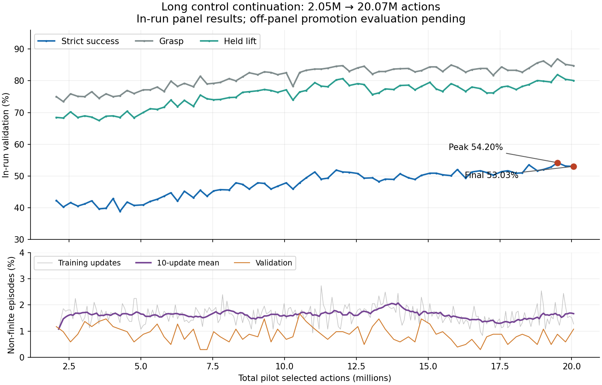

# Long control continuation: evaluation and endpoint promotion

**Latest status (2026-10-19):** matched evaluation now promotes the 40M final
checkpoint. See the [40M review and 60M resume command](CDPR_40M_CONTROL_REVIEW_20261019.md).
The 20M results and 40M launch command below are retained as historical evidence.

Reviewed 2026-10-12 from the user-supplied TensorBoard event file and pasted
terminal summary. Run: `latent_control_long_20261009_160735`, reported Git
`2b15660361d2b612048f85652dcf521b07ec57e6`.

## Actual run and evidence

The console reports a **20,000,000-action cap**, not the 10M command previously
given in chat. The event history confirms resume at **2,052,558** and finish at
**20,068,312**, adding **18,015,754** selected actions. This is the observed
executed budget; its override is not evidence of a launcher fault.

There are 237 new training updates (261 cumulative since conversion), 485,376
new episodes, 121,099 new optimizer steps and 73 validation evaluations.
Recorded training elapsed time is 72.26 hours, excluding startup/preflight
and initial validation. LoRA max change is zero in all 237 update readings.
LR remains approximately 1e-5; TensorBoard float precision explains its stored
`9.999999747e-6` representation.

Evidence hashes and counters are in
[summary.json](../../artifacts/latent_control_long_20261012/summary.json).
All 73 validation rows are in
[validation.csv](../../artifacts/latent_control_long_20261012/validation.csv).
The event file was read with scalar sampling disabled. Checkpoint IDs below
come from integer **Event.step** metadata, not rounded console output or
float32 scalar counters. This matters above 16,777,216, where not every integer
is exactly representable by a float32 scalar.



## Learning and health

| In-run validation | Resume, 2,052,558 | Peak, 19,503,223 | Final, 20,068,312 |
|---|---:|---:|---:|
| Strict successes / 1024 | 433 | 555 | 543 |
| Strict rate | 42.29% | 54.20% | 53.03% |
| Physical grasp | 75.00% | 86.91% | 84.77% |
| Held lift | 68.46% | 81.93% | 80.08% |
| Plate strict | 46.48% | 59.96% | 59.38% |
| Bowl strict | 38.09% | 48.44% | 46.68% |
| Carry slip | 25.10% | 27.05% | 26.17% |
| Non-finite episodes | 1.17% | 0.88% | 1.07% |

Strict validation gains 10.74 percentage points from this run's initial
measurement to its endpoint. Improvement persists across many evaluations,
rather than relying on a single peak. The 10M crossing, step 10,061,112, scores
47.85%. Progress slows around 12–18M but late results still improve. The
endpoint is only 12 successes / 1.17 pp below the peak; these aggregate panel
readings do not establish that the peak is a better deployment policy.

Non-finite live training episodes total 7,874/485,376 = 1.622%. The first and
last 20-update mean rates are 1.636% and 1.650%; there is no sustained growth
like the rejected correction candidate's. Per-update range is 0.830–2.734%.
Median sampled KL is 0.003349 and maximum 0.030729. PPO clip fraction ranges
1.245–2.101%. Gradient means are finite (4.41–6.33); occasional pre-clip peaks
remain, up to 377.96. Recorded loss/KL/gradient/std streams have full update
coverage and finite values. These aggregates do not prove every internal
tensor or physical contact was finite.

**TensorBoard limitation:** the training writer skips non-finite scalars.
Both pad-force streams have only 187 entries for 237 updates. The 50 missing
entries are consistent with the prior contact-telemetry issue; their exact
raw values cannot be recovered from this event file. An absence of NaNs in
TensorBoard is not proof that every metric was finite. JSONL remains the
authoritative source for diagnosing those missing readings if needed.

## Which checkpoints to keep and evaluate

Each directory must contain `smolvla_grpo_adapter.pt`. Paths below are relative
to `/root/repo/RL_VLA_Bootstrapping` on the server:

| Role | Checkpoint directory |
|---|---|
| Primary new endpoint | `runs/latent_control_long_20261009_160735/rl/step_20068312` |
| Secondary, selected by the in-run panel | `runs/latent_control_long_20261009_160735/rl/step_19503223` |
| Promoted baseline | `runs/latent_2m_control_20261009_033534/rl/step_2052558` |

Preserve the original `runs/three_stage_sparse_grpo_20260925_105132/rl/step_56072006`
as the historical source, but it need not be reevaluated to measure the gain
from this continuation. Optional learning-budget comparison:
`runs/latent_control_long_20261009_160735/rl/step_10061112`. It is not needed
for the initial three-checkpoint decision. Do not delete other checkpoints
as part of this handoff.

The trainer saves on validation and at the endpoint, so both shortlisted long
run steps should have checkpoint directories. They were not inspected locally;
the evaluator checks file existence before allocating the evaluation jobs.
Use these explicit step directories, not a moving `latest.pt` alias.

## Completed comparison protocol (historical handoff)

Run the same 512-scene off-panel development protocol, four repeats for each
of the three checkpoints (6,144 episodes total). Baseline is now the promoted
2M control. The endpoint is the primary result; the panel-selected peak is a
secondary result. The comparator applies Holm correction to the two strict
comparisons and reports the existing 3 pp grasp/lift retention rule. Continue
to include non-finite outcomes. These remain development results on a reused
development set, not untouched final-test evidence.

```bash
cd /root/repo/RL_VLA_Bootstrapping
git pull --ff-only
unset SCENE_LIST SCENE_CLASS CONTROLLER_Z_MAX STOCHASTIC_SEED
LONG=runs/latent_control_long_20261009_160735/rl
BASE=runs/latent_2m_control_20261009_033534/rl/step_2052558
OUT="runs/latent_control_long_comparison_$(date +%Y%m%d_%H%M%S)"

CHECKPOINTS="control2m=$BASE final20m=$LONG/step_20068312 peak19m=$LONG/step_19503223" \
  OUT_ROOT="$OUT" REPEATS=4 GPUS="0 1" WORLDS=64 ROUNDS=8 \
  CONFIG=configs/examples/cdpr_smolvla_three_stage_put_into.yaml \
  SCENES=runs/three_stage/scenes_8192.json SPLIT=student_validation \
  SCENE_MANIFEST=runs/three_stage/scenes_8192.json RETENTION_MARGIN=0.03 \
  DECISIONS=128 SETTLE_DECISIONS=0 PRIOR_NOISE_SCALE=1 EXCLUDE_VALIDATION_PANEL=1 \
  bash scripts/compare_cdpr_three_stage_repeats_remote.sh &&
conda run --no-capture-output -n cdpr-mjlab python3 tools/audit/compare_put_into_repeats.py \
  --checkpoint "final20m=$OUT/final20m/rep1,$OUT/final20m/rep2,$OUT/final20m/rep3,$OUT/final20m/rep4" \
  --checkpoint "peak19m=$OUT/peak19m/rep1,$OUT/peak19m/rep2,$OUT/peak19m/rep3,$OUT/peak19m/rep4" \
  --retention-margin 0.03 --scene-manifest runs/three_stage/scenes_8192.json \
  --output "$OUT/peak_vs_final.json"
```

Return `comparison.json` and `peak_vs_final.json` from the printed output
directory; no model-weight upload is required. The second command only
reanalyzes existing episode results on CPU. Keep the same `OUT` directory
when resuming interrupted evaluations, rather than generating another timestamp.

Evaluate before extending again so the next resume source can be selected on
matched evidence. If both new checkpoints pass against the 2M baseline and
the peak has no clear advantage over the endpoint, prefer the primary endpoint
rather than selecting on the noisier in-run maximum. A materially better peak
requires its own retention and simulator-health assessment. Do not unlock
`final_test` during this checkpoint selection.

## Local changes and checks

Fixed the pilot reporter to print integral counters/steps exactly, so users
can identify checkpoint directories without decoding rounded scientific
notation. Eighteen reporter tests pass, including exact large-step formatting.
The evaluation command block passed shell syntax checking; no remote training
or evaluation was launched locally and no optimizer/simulator behavior changed.

## Matched results received: promote final20m

Evidence from `latent_control_long_comparison_20261012_202417`:
[comparison.json](../../artifacts/latent_control_long_comparison_20261012/comparison.json)
and [peak_vs_final.json](../../artifacts/latent_control_long_comparison_20261012/peak_vs_final.json).
Both reports agree on checkpoint hashes, repeat directories, aggregates and
protocol. They cover 512 development scenes, four repeats / 2,048 episodes
per checkpoint, excluding the 128-scene training validation panel. The direct
peak/final report reuses the same episodes; it is not additional replication.

| Checkpoint | Strict successes | Strict | Grasp | Held lift | Non-finite |
|---|---:|---:|---:|---:|---:|
| control2m | 784/2048 | 38.28% | 75.05% | 68.07% | 0.98% |
| final20m | 1095/2048 | 53.47% | 85.99% | 82.23% | 0.88% |
| peak19m | 1072/2048 | 52.34% | 86.28% | 82.28% | 1.07% |

Final versus 2M: **+15.19 pp strict**, scene-paired 95% bootstrap interval
**[+12.70, +17.68] pp**, Holm p=0.00010. All four repeats improve (by 81,
78, 76 and 76 successes). Grasp +10.94 pp, CI [+8.89, +13.09]; held lift
+14.16 pp, CI [+11.72, +16.65]. Both exceed the −3 pp retention floor.
This retention check concerns grasp/lift within full-task put_into episodes;
it does not establish retention across other instruction families.

The peak also passes against 2M, but peak minus final is −1.12 pp strict,
CI [−3.22, +0.98], p=0.30808. There is no demonstrated advantage for switching
to the panel-selected peak, nor proof the checkpoints are equivalent. Select
the predesignated primary endpoint, which also has the higher point estimate.
The direct report's `no_promotion:strict_interval_not_above_zero` refers to
promoting peak over final; it does not reverse final's promotion over 2M.

The baseline is 38.28% in these reruns versus 41.16% in the earlier comparison.
Use the contemporaneous matched baseline, not a cross-run subtraction. Repeat
variability is present; the large matched gain is consistent across all four
repeats. These reports alone do not identify the cause of the baseline shift.

Final's non-finite difference is −0.10 pp, CI [−0.78, +0.54]; no detected
increase, but not proof of equivalence. Carry-slip and wrong-place intervals
also cross zero. The increased success comes with better grasp/lift and
strict-given-lift (56.24% → 65.02%), not a demonstrated reduction in either
of those error rates. The outcome flags need not be mutually exclusive.

Both destination types improve: bowl 33.92% → 48.14%, plate 42.61% → 58.75%.
All four object types and target-y quartiles have positive reported strict
intervals (exploratory subgroup intervals, not multiplicity-adjusted claims).
Remaining weaknesses include potato strict 41.80%, bowl 48.14%, and Q4 target-y
strict 13.76% versus Q1 82.69%. These identify future analysis targets, not a
reason to change the successful objective or learning rate now.

## Next training: resume final20m to 40M total actions

Selected checkpoint:
`runs/latent_control_long_20261009_160735/rl/step_20068312/smolvla_grpo_adapter.pt`.
SHA-256: `d6c4aacd1e5dfbc59d230983c4a420f5e7aedb38e2fdb75f3e8196232f16de47`.

Recommend one substantial continuation with the same architecture, task,
LR=1e-5, PPO epochs=1, frozen LoRA and existing validation/checkpoint cadence.
**40M is a proposed next budget, not an established optimum**: it adds
19,931,688 selected actions before the final full-rollout overshoot. Based
on the last leg's throughput, allow roughly 80 training hours plus startup;
actual runtime and further gains are uncertain. No extra pilot or evaluation
is required before this continuation. Keep final_test untouched during model
selection. The launcher name retains `pilot` for historical reasons.

```bash
cd /root/repo/RL_VLA_Bootstrapping
git pull --ff-only && \
env -u LEGACY_INIT_CHECKPOINT -u WARMSTART_CHECKPOINT \
  ARM=control \
  RESUME_CHECKPOINT=runs/latent_control_long_20261009_160735/rl/step_20068312 \
  EXPECTED_SOURCE_SHA256=d6c4aacd1e5dfbc59d230983c4a420f5e7aedb38e2fdb75f3e8196232f16de47 \
  MAX_TRAIN_STEPS=40000000 MAX_UPDATES=0 \
  PPO_EPOCHS=1 LR_OVERRIDE=1e-5 PRIOR_NOISE_SCALE=1 \
  CONFIG=configs/examples/cdpr_smolvla_three_stage_put_into_latent_correction.yaml \
  SCENES=runs/three_stage/scenes_8192.json \
  CUDA_VISIBLE_DEVICES=0,1 WORLDS_PER_RANK=512 SMOLVLA_MICROBATCH_SIZE=256 \
  RUN_PREFLIGHT=1 DRY_RUN=0 RUN_LABEL=latent_control_to40m \
  bash scripts/train_cdpr_latent_correction_pilot_remote.sh
```

The source hash checks the resumed 20M adapter, not the original legacy source.
`MAX_UPDATES=0` removes the update cap; 40M is cumulative in the repaired-
likelihood lineage and does not add the historical 56M source counter.
Preserve the 20M promoted endpoint as the next matched evaluation baseline,
the 19.5M alternative and the historical 2M/original source checkpoints.
After completion return metrics.jsonl, validation.jsonl and the launcher
summary; evaluate the new endpoint against 20M before choosing another source.
No remote training was launched locally. This update changes documentation
and preserves supplied evidence; it changes no training or evaluation code.

## October 19 console confirmation

The [new console excerpt](../../artifacts/latent_control_console_20261019/console.txt)
contains the same run name, 20M cap, initializer hash and final checkpoint as
this report. All 237 update rows parse, and all 73 validation readings match
the retained event export at the printed precision; see the
[verification summary](../../artifacts/latent_control_console_20261019/review.json).
This is additional provenance for the existing run, not an independent run or
evidence of a finished 40M continuation.

The recommendation remains to execute the 40M-total resume command above with
unchanged parameters. The matched improvement and stable recorded training
health support another substantial continuation; there is no demonstrated
need to switch architecture, rewards or learning rate now. Preserve 20M as
the next matched baseline. Reconsider the method after a continuation without
a demonstrated gain, retention loss or sustained simulator-health degradation;
use carry/placement and target-y diagnostics to choose a targeted intervention.
No extra pilot is needed. The console's pad-force/EPA warnings remain visible;
they do not establish NaN optimizer loss or repair simulator contact health.
