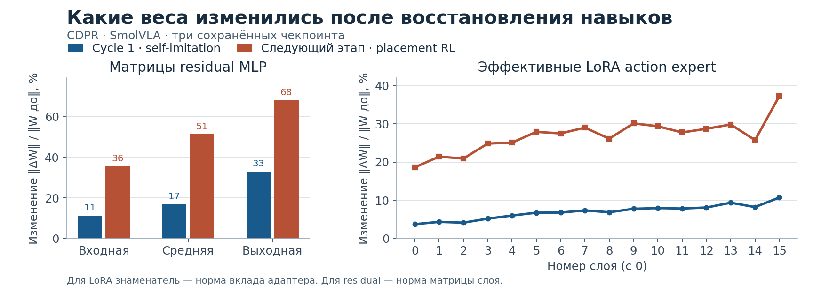
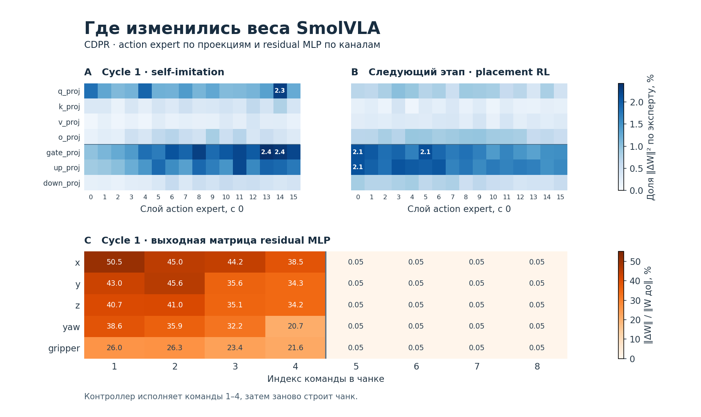

# Забывание и восстановление навыков в чекпоинтах CDPR SmolVLA

## Что видно в Cycle 1

Есть два локальных файла одной линии: placement RL `step_1504301`, когда `move_to_object` уже просел, и его прямой потомок `retention_cycle1_e60` после self-imitation SFT. В метаданных второго файла указан первый как источник. Третий локальный файл, `step_7753190`, получен в следующем placement RL, начатом с `retention_cycle1_e60`. [Архив и происхождение файлов](../../local_results/cdpr_phase4_retention_archive/README.md)

Сохранённый протокол Cycle 1 показывает улучшение старого навыка и обоих вариантов текущего. Placement здесь начинается с удерживаемого предмета. Это оценки из отчёта, полученные до анализа весов. [Отчёт Phase 4](../reports/campaign/CDPR_PHASE4_RETENTION_REPORT.md#1-headline-results)

| Навык и ограничение на начальную дистанцию | До SFT | После SFT | Разница |
| --- | ---: | ---: | ---: |
| `move_to_object`, 0,19 м | 8,0% | 31,1% | +23,1 п.п. |
| `put_into_plate`, 0,20 м | 50,0% | 52,3% | +2,3 п.п. |
| `put_into_bowl`, 0,20 м | 23,05% | 27,65% | +4,60 п.п. |

### Изменения сохранённых весов

На CPU сравнили тензоры `policy` и эффективные добавки LoRA `ΔW = (α/r)BA`. Для относительных величин норма изменения делится на норму соответствующей группы перед переходом. Для LoRA знаменатель — вклад адаптера, для residual — сохранённые параметры MLP. Сила влияния на действие проверяется отдельно.

| Компонент | Placement RL → Cycle 1 SFT | Cycle 1 SFT → следующий placement RL |
| --- | --- | --- |
| Residual MLP, все веса и смещения | 16,1% | 46,7% |
| Входная / средняя / выходная матрицы residual | 11,3% / 16,9% / 33,0% | 35,6% / 51,3% / 68,1% |
| LoRA action expert | 6,47% · изменились 112 из 112 модулей | 25,62% · изменились 112 из 112 |
| LoRA зрительного энкодера | 72 новых модуля с ненулевым вкладом | В новом файле нет этих 72 модулей |
| Параметр `log_std` | Все 40 значений совпали | Изменились 14 из 40 значений |

В Cycle 1 самые большие абсолютные сдвиги LoRA action expert по норме Фробениуса были в слоях 14, 13 и 11 (нумерация с нуля). У двух наиболее изменившихся отдельных проекций это `mlp.gate_proj` слоёв 13 и 14. Для следующего RL лидировали слои 3, 5 и 6. Базовый SmolVLA заявлен в метаданных как `lerobot/smolvla_base` во всех трёх файлах. Самих тензоров базовой модели в этих адаптерах нет, поэтому сравнение касается сохранённых параметров и дельт.



### Какие проекции и каналы изменились

Сравнение `step_1504301` → `retention_cycle1_e60`. Для каждой проекции эксперта измеряем разность **эффективных** добавок LoRA. Норма в таблице делится на норму добавки LoRA до SFT. Последний столбец показывает, какая доля квадрата нормы разности приходится на её первое сингулярное направление.

| Проекция action expert | Роль в вычислении | Изменение от нормы до SFT | Доля первого сингулярного направления |
| --- | --- | ---: | ---: |
| Слой 13 · `mlp.gate_proj` | Вычисляет коэффициенты, модулирующие промежуточные признаки MLP | 9,68% | 64,80% |
| Слой 14 · `mlp.gate_proj` | Модулирует промежуточные признаки в следующем слое | 10,26% | 76,86% |
| Слой 14 · `self_attn.q_proj` | Преобразует скрытое состояние в запросы всех голов внимания слоя | 6,71% | 87,09% |

Это три наибольших **абсолютных** изменения среди отдельных проекций. У следующего placement RL три лидера — `gate_proj` слоёв 5 и 0 и `up_proj` слоя 0. В Cycle 1 `gate_proj` и `up_proj` вместе дают 54,4% от суммы квадратов сдвигов эксперта. Этот показатель зависит от размеров матриц. При нормировке на число элементов крупнейший RMS-сдвиг среди семи семейств проекций дают `k_proj` и `q_proj`. Сингулярные направления описывают геометрию обновления весов. Их связь с выбором цели или управлением проверяется по активациям и действиям на одних и тех же кадрах.

**Residual MLP.** Выходная матрица содержит восемь блоков по пять команд `[x, y, z, yaw, gripper]`. На первые четыре приходится **99,99999% квадрата нормы её изменения**. Контроллер исполняет эти четыре команды до перепланирования, и SFT маскирует оставшиеся позиции чанка. В исполняемой части относительный сдвиг матриц составляет 43,5% для `x`, 38,3% для `y`, 37,3% для `z`, 29,4% для `yaw` и 24,1% для `gripper`. `z` даёт наибольший абсолютный сдвиг среди пяти каналов. Это повод проверить коррекцию подхода и высоты на траекториях, включая знак фактического изменения команды. [Маска SFT](../../tools/audit/sil_sft.py#L53)

На входе residual относительная норма изменения почти одинакова у колонок проприоцепции и зрительных признаков (11,70% и 11,71%). У колонок, читающих исходный action chunk SmolVLA, она 5,77%. Зрительный блок занимает 512 из 558 колонок, поэтому его большой вклад в суммарный сдвиг ожидаем по размеру. [Контракт входа residual](../../rl_vla_bootstrapping/policy/smolvla_grpo_finetune_cdpr.py#L2649)



### Проверка загрузки зрительных адаптеров

В SFT-файле есть ненулевые vision LoRA, но его сохранённое поле `args.train_vla_vision_lora` равно `false`. Текущий оценщик строит LoRA по сохранённым аргументам, затем вызывает `load_state_dict(..., strict=False)` без проверки списка `unexpected_keys`. При этих метаданных зрительные адаптеры могут не попасть в модель. Исторический запуск оценки нужно воспроизвести с логом реально загруженных ключей. В частности, нельзя использовать наличие vision LoRA в файле как свидетельство его вклада в опубликованные проценты. [Построение оценочной политики](../../tools/audit/xy_approach_probe.py#L575) · [Загрузка LoRA](../../rl_vla_bootstrapping/policy/smolvla_grpo_finetune_cdpr.py#L2999)

## Как локализовать забывание и восстановление

1. **Поднять ранний чекпоинт A.** В архиве есть оценка специализированного `move_to_object` (`step_11009573`), сам `.pt` указан среди файлов на сервере. Сравнить A с просевшим B (`step_1504301`) и восстановленным C (`retention_cycle1_e60`) на одном наборе отложенных reset’ов. Для каждого навыка зафиксировать объекты, начальные условия, критерий успеха, горизонт и шумовые seed. Сверить цепочку промежуточных запусков между A и B. Это превратит историческое сравнение в парное измерение. [Список недостающих файлов](../../local_results/cdpr_phase4_retention_archive/README.md#still-needed-from-the-remote-server)
2. **Посмотреть, где меняется вычисление.** Подать A, B и C одинаковые кадры, текст и состояние, с одинаковым начальным шумом SmolVLA. Сравнить послойный дрейф активаций по CKA и парному RMS, а также `prior`, поправку residual и исполненное действие по XYZ, yaw и захвату. Разобрать каждую задачу отдельно. Для поздних шагов flow matching полезен также прогон с общим входным состоянием декодера на выбранном шаге, чтобы разделить локальный эффект слоя и накопленный дрейф траектории. [CKA](https://proceedings.mlr.press/v97/kornblith19a.html) · [Послойный анализ VLA](https://aclanthology.org/2026.emnlp-main.2076/)
3. **Подменить компоненты между B и C.** Оценить B и C и два гибрида: residual из C с action-expert LoRA из B и residual из B с action-expert LoRA из C. Для всех четырёх комбинаций зафиксировать режим vision LoRA, затем отдельно проверить, что изменится при его включении. Если гибриды указывают на один компонент, повторить подстановку внутри него по слоям. Сравнивать дельты успеха отдельно для `move_to`, plate и bowl на одних и тех же reset’ах. Это проверит, восстанавливает ли один и тот же компонент старый навык и улучшает ли текущий.
4. **Проверить вклад состава банка.** Если нужно отнести улучшение к self-imitation старых и новых навыков, сравнить SFT из B на старых траекториях, на текущих траекториях и на их смеси при одинаковом бюджете оптимизации. Пара B→C даёт совместный эффект конкретного обучения. Эти контроли оценивают, сколько добавляет каждый источник демонстраций.

Ключевая гипотеза — после placement RL зрительные и языковые признаки старого навыка остаются доступными, а меняется их связь с моторной командой. Быстрое восстановление прошлых задач после небольшого числа шагов дообучения наблюдали и в continual learning VLA на LIBERO. Здесь можно проверить, объясняется ли конкретное восстановление residual MLP, изменениями action expert или их взаимодействием. [Pretrained VLA and continual learning, §5](https://arxiv.org/html/2603.03818v2)

## Работы для сопоставления

Q1 ниже относится к журналу и категории по SCImago SJR 2025.

| Рецензируемая работа | Что взять для SmolVLA |
| --- | --- |
| **Holton et al.**, *Nature Human Behaviour*, Q1 Experimental and Cognitive Psychology. [Статья](https://pmc.ncbi.nlm.nih.gov/articles/PMC12846915/) · [SJR](https://www.scimagojr.com/journalsearch.php?clean=0&q=21100838541&tip=sid) | Авторы сравнили углы между подпространствами **активаций** двух задач, чтобы объяснить совместный перенос и интерференцию. На фиксированных отложенных наблюдениях можно оценить, переиспользуются ли представления целевой геометрии между `move_to` и placement. |
| **Kirkpatrick et al.**, *PNAS*, 2017, Q1 Multidisciplinary. [Статья](https://pubmed.ncbi.nlm.nih.gov/28292907/) · [SJR](https://www.scimagojr.com/journalrank.php?area=1000) | Авторы оценивали важность параметров для прежней задачи через информацию Фишера и проверяли чувствительность поведения к изменению весов. Здесь ближайший тест — подстановка `gate_proj` или `q_proj` между B и C и измерение вклада в общий успех и выбор цели. |
| **Shi et al.**, *IEEE Transactions on Robotics*, 2026, Q1 Computer Science Applications. [Статья](https://ieeexplore.ieee.org/abstract/document/11488937) · [SJR](https://www.scimagojr.com/journalsearch.php?clean=0&q=95101&tip=sid) | Авторы проверяют, как разнообразие задач и сцен связано с устойчивостью манипуляции при сдвиге распределения. У нас стоит удерживать целые группы раскладок и комбинаций предмет–ёмкость для независимой оценки. |

Два особенно близких рецензируемых доклада посвящены непосредственно забыванию. Ramasesh et al. сравнивали представления и делали послойный сброс весов. В их задачах классификации поздние слои сильнее влияли на забывание. У нас сильные сдвиги после SFT в `gate_proj` слоёв 13–14 дают кандидатов для такого вмешательства. Liu et al. показали быстрое восстановление прошлых задач у VLA на LIBERO и исследовали replay. Это ориентир для сравнения быстроты и полноты восстановления после self-imitation. [Ramasesh et al., ICLR 2021](https://openreview.net/forum?id=O5nVwJ8cB6) · [Liu et al., ICML 2026](https://proceedings.mlr.press/v306/liu26bu.html)

## Проверка переноса на новые сцены

Ранний `move_to` уже проверялся на 128 сценах с другим seed и дал 59,47%. В сценарии с несколькими предметами он достигал названной цели в 27,2% случаев, когда она была дальше отвлекающего предмета, и достигал неверного предмета в 40,9%. Эти данные относятся к `step_11009573` и дают контроль того, насколько выбор простого ближайшего объекта мог объяснять успех. [Архивная оценка, §2 и §3.3](../../local_results/cdpr_phase4_retention_archive/reports/CDPR_MOVE_TO_VALIDATION_REPORT.md)

Основной парный тест для B и C — два запуска из одинакового reset’а с одинаковым шумом. В сцене есть две видимые и достижимые цели в противоположных направлениях. Между запусками меняем только названную цель. Для `move_to` меняем название предмета. Для placement оставляем один и тот же удерживаемый предмет и меняем указанную ёмкость. Меняем раскладки и порядок ближней и дальней цели между reset’ами. Оцениваем направление первого заметного смещения в XY, правильный выбор цели и выполнение обоих вариантов в паре. Для placement дополнительно отслеживаем сохранение захвата при переносе и отпускание в указанной ёмкости. Сравниваем с эвристикой ближайшей цели, повтором записанного action chunk и базовым чекпоинтом до SFT. Новые позиции и комбинации отделяются от банка по исходным сценам, а неопределённость оценивается по reset’ам.

Связь внутреннего изменения с переносом проверяем на тех же парах. Для каждого чекпоинта измеряем, насколько линейный probe декодирует вектор к **названной** цели на новых раскладках, и меняется ли правильное переключение цели при подстановке кандидатов из слоёв 13–14. Для проверки специфичности эффекта сравниваем с подстановкой проекции того же типа из другого слоя. Искомый результат — выигрыш после SFT на контрфактических задачах и воспроизводимый вклад конкретной проекции или residual в этот выигрыш.

## Повторить сравнение весов

Из корня репозитория, в окружении с PyTorch:

```bash
archive=local_results/cdpr_phase4_retention_archive/checkpoints
python tools/audit/compare_smolvla_checkpoint_weights.py \
  "$archive/placement_iter1_step_1504301/smolvla_grpo_adapter.pt" \
  "$archive/retention_cycle1_e60/sil_sft_adapter.pt" \
  --output /tmp/cdpr_cycle1_weights.json
```

JSON содержит нормы и число изменившихся элементов каждого тензора, метаданные и добавленные или удалённые модули LoRA. Для совместимых CDPR-адаптеров он также разбивает выход residual по шагам и каналам и показывает спектры трёх крупнейших изменений внутри action expert. Сравнение выполняется на CPU без загрузки базовой SmolVLA или симулятора.

## Прогоны на чекпоинтах SmolVLA

### Какие файлы нужны

| Линия | Роль | Файл |
| --- | --- | --- |
| CDPR, историческая | **A**, сильный `move_to` до placement | `runs/phase4_move_to_iter0_resume_20260818_080928/rl/step_11009573/smolvla_grpo_adapter.pt` (забрать с сервера) |
| CDPR, историческая | **B**, placement RL до SIL | `local_results/cdpr_phase4_retention_archive/checkpoints/placement_iter1_step_1504301/smolvla_grpo_adapter.pt` |
| CDPR, историческая | **C**, прямой потомок B после первого retention SIL | `local_results/cdpr_phase4_retention_archive/checkpoints/retention_cycle1_e60/sil_sft_adapter.pt` |
| CDPR, историческая | **D**, следующий placement RL | `local_results/cdpr_phase4_retention_archive/checkpoints/placement_iter2_peak_step_7753190/smolvla_grpo_adapter.pt` |
| CDPR, актуальная по отчёту | Сопоставимое продолжение 40M → 60M | `runs/latent_control_to40m_20261012_230538/rl/step_40056193/smolvla_grpo_adapter.pt` и `runs/latent_control_to60m_20261019_224018/rl/step_60025885/smolvla_grpo_adapter.pt` |
| WidowX, свежая линия | **WA**, принятая политика после move_to | `runs/widowx200_pipeline_fresh_20261104_162138_CBEU9r/sil/s4_move_to_binary_sil1/sft/sil_sft_adapter.pt` |
| WidowX, свежая линия | **WB**, stage 6 перед SIL | `runs/widowx200_pipeline_fresh_20261104_162138_CBEU9r__s6_put_into_binary/rl/step_3763946/smolvla_grpo_adapter.pt` |
| WidowX, свежая линия | **WC**, принятый stage 6 после SIL и инициализатор исходного stage 7 | `runs/widowx200_pipeline_fresh_20261104_162138_CBEU9r/sil/s6_put_into_binary_sil1/sft/sil_sft_adapter.pt` |
| WidowX, текущая тренировка | **W0**, фактический инициализатор job, и **W1**, последний полностью записанный `step_*` того же job | Сверить с логом запуска и run-dir. Для известного contact-v2 retry уже проверялся `runs/widowx200_s7_contact_v2_20261113_135223/rl/step_0502404/smolvla_grpo_adapter.pt`. |

Для CDPR 60M — последний подтверждённый репозиторием полноценный результат. План продолжения до 80M опубликован рядом с ним. Если сервер уже выпустил более поздний результат той же линии, взять его каталог и точный resume-источник из лога. Сравнение 40M → 60M показывает изменение при joint RL с замороженной LoRA. Если `make` подтверждает нулевое эффективное изменение проекций, достаточно полных политик и probe для контроля стабильности эксперта. **B → C** и **WB → WC** дают прямое сравнение до и после SIL. **A → B** и **WA → WB** подходят для проверки забывания при условии, что на новой общей панели сначала подтверждается падение старого навыка. [Отчёт CDPR 60M](../reports/campaign/CDPR_60M_CONTROL_REVIEW_20261104.md) · [Consolidated Progress Report](../../CDPR_CONSOLIDATED_PROGRESS_REPORT.md) · [Протокол WidowX contact-v2](../WIDOWX200_CONTACT_GRASP_FIX.md)

Для текущего WidowX взять также конфиг фактического job, два его eval-конфига и метаданные инициализации. Для списка готовых файлов в уже известном каталоге job: `find "$RUN_DIR/rl" -path '*/step_*/smolvla_grpo_adapter.pt' -type f | sort -V | tail -5`. Сверить шаг с логом завершённого сохранения. В опубликованном snapshot исходный stage 7 (`step_5020693`) и contact-v2 retry — разные запуски. На сервере зафиксировать W0/W1 неизменяемыми путями и хешами, использовать соответствующий grasp contract для всех веток. Приведённая ниже оценка запускается отдельным процессом и пишет в отдельный каталог. [Снятие snapshot и восстановление конфигов WidowX](../WIDOWX200_POSTRUN_DIAGNOSIS.md)

### 1. Перенос направления между навыками

Из одного и того же набора первого наблюдения для каждой политики извлекаем выход MLP каждого слоя action expert на первом токене действия, на раннем и позднем шагах денойзинга. Метка в обеих задачах — единичный вектор в XY от энд-эффектора к указанной цели. Для `move_to` цель — предмет, для placement из удержания — ёмкость. Панель хранит кадры, текст, проприоцепцию и отдельную геометрическую метку. Веса probe оцениваются на одном навыке и применяются к другому в обоих направлениях. В отчёте есть сравнение с probe внутри навыка, постоянным направлением, проприоцепцией и pooled vision, а также угловая ошибка и фактическое направление первой команды. Совпадающий readout через навыки свидетельствует об общей линейно читаемой информации. Эффект на управление проверяется подстановкой и парными прогонами.

Пример CDPR из корня репозитория на свободном GPU. `0.19` и `0.20` ниже — фиксированные пилотные caps. Если цель — повторить конкретную опубликованную оценку, взять число из её manifest. Для WidowX использовать пути и caps из сохранённых `eval/final/move_to` и `eval/final/put_into` (`pipeline_selection` в `tools/audit/policy_outcome_videos.py`), обычно 0.30 и 0.18. В окружении WidowX экспортировать `RLVLA_EMBODIMENT=widowx200`; режим composed оценивать отдельно.

```bash
export RLVLA_EMBODIMENT=cdpr MUJOCO_GL=egl PYTHONUNBUFFERED=1
py() { conda run --no-capture-output -n cdpr-mjlab python "$@"; }
root=$(mktemp -d "$PWD/runs/smolvla_skills_XXXXXX")
arc=local_results/cdpr_phase4_retention_archive/checkpoints
A=runs/phase4_move_to_iter0_resume_20260818_080928/rl/step_11009573/smolvla_grpo_adapter.pt
B="$arc/placement_iter1_step_1504301/smolvla_grpo_adapter.pt"
C="$arc/retention_cycle1_e60/sil_sft_adapter.pt"
D="$arc/placement_iter2_peak_step_7753190/smolvla_grpo_adapter.pt"
move_config=configs/examples/cdpr_smolvla_phase4_move_to_loop.yaml
place_config=configs/examples/cdpr_smolvla_phase4_placement_loop.yaml
move_cap=0.19
place_cap=0.20
device=cuda:0

py tools/audit/smolvla_skill_panel.py capture --checkpoint "$B" --config "$move_config" \
  --skill move_to --cap "$move_cap" --controller-workspace-from-checkpoint --device "$device" --worlds 128 --rounds 8 --output "$root/move"
py tools/audit/smolvla_skill_panel.py capture --checkpoint "$B" --config "$place_config" \
  --skill placement --cap "$place_cap" --device "$device" --worlds 128 --rounds 8 --output "$root/place"

for label in B C D; do
  case "$label" in B) ckpt=$B ;; C) ckpt=$C ;; D) ckpt=$D ;; esac
  py tools/audit/smolvla_direction_probe.py extract --checkpoint "$ckpt" \
    --panel "$root"/move/panel_*.npz "$root"/place/panel_*.npz \
    --device "$device" --output "$root/$label.features.npz"
  py tools/audit/smolvla_direction_probe.py analyze --features "$root/$label.features.npz" \
    --output "$root/$label.direction.json"
done
py tools/audit/smolvla_direction_probe.py cka --before "$root/B.features.npz" \
  --after "$root/C.features.npz" --output "$root/B_to_C.cka.json"
```

После появления A повторить `extract` с теми же файлами и сравнить A/B по CKA. Зафиксировать порядок файлов, размер batch, начальный шум и вариант vision LoRA. Для контроля зрения запустить `extract --shuffle-images`: обзор и запястье переставляются вместе внутри одинакового prompt/каталога. Подать этот файл как `analyze --test-features` вместе с первоначальным `--features`, чтобы применить тот же обученный probe. Если категория представлена одним кадром в раунде, нужен больший `--worlds`. Для быстрого запуска взять `--worlds 32 --rounds 1` и `extract --layer 13 --layer 14`. Этого достаточно для проверки пайплайна. Для выводов использовать полную панель и несколько фиксированных noise seed. Поздние активации включают накопившиеся различия денойзинга. [LeRobot SmolVLA](https://github.com/huggingface/lerobot/blob/v0.4.4/src/lerobot/policies/smolvla/smolvlm_with_expert.py) · [Kornblith et al., CKA](https://proceedings.mlr.press/v97/kornblith19a.html)

### 2. Подстановка отдельных проекций

Сохраняем residual B и меняем обе LoRA-матрицы выбранной проекции на C. Основные ветки — `13:gate_proj`, `14:gate_proj` и `14:q_proj` (индексация с нуля). Контроль: проекции того же типа из середины эксперта, все экспертные LoRA, только residual донорской политики, полная донорская политика и повтор B. В `manifest.json` указаны точные имена ключей, хеши исходников и норма эффективного изменения `(α/r)Δ(BA)`. Эффективные no-op пропускаются. По умолчанию исторические B и C оцениваются со снятой vision LoRA во всех ветках. Для пары с одинаковым сохранённым набором vision-проекций есть `--vision saved`.

```bash
# make можно запустить локально с PyTorch и NumPy
py tools/audit/smolvla_skill_interventions.py make --recipient "$B" --donor "$C" \
  --experiment projection --projection 13:gate_proj --projection 14:gate_proj \
  --projection 14:q_proj --projection 7:gate_proj --projection 7:q_proj \
  --output "$root/recovery"

# Серверный пилот и такой же пилот на placement
py tools/audit/smolvla_skill_interventions.py evaluate --manifest "$root/recovery/manifest.json" \
  --config "$move_config" --cap "$move_cap" --controller-workspace-from-checkpoint --round-index 150 --rounds 1 \
  --worlds 32 --device "$device" --output "$root/recovery_move_smoke"
py tools/audit/smolvla_skill_interventions.py evaluate --manifest "$root/recovery/manifest.json" \
  --config "$place_config" --cap "$place_cap" --round-index 150 --rounds 1 \
  --worlds 32 --device "$device" --output "$root/recovery_place_smoke"
```

После пилота использовать независимые раунды, например `--round-index 200 --rounds 8 --worlds 128`. Обе A40 можно задействовать через `--devices cuda:0,cuda:1`, если обе свободны. При активной тренировке указать только свободную карту. Все ветки используют один конфиг, cap, seed и budget. Оценщик сверяет начальные позы и назначение цели, затем считает разницу в успехе, число улучшившихся и ухудшившихся эпизодов и интервал по группам reset. Проверять отдельно move-to, plate и bowl по полю `instruction` в `paired.json`. Если повтор B меняет вердикты примерно настолько же, насколько подстановка, добавить независимые раунды, прежде чем интерпретировать эффект.

### 3. Какие группы сцен откладываем

- **Пространство.** Целиком отложить NE (`dx > 0, dy > 0` вне осей, в координатах мира) для обоих навыков. В следующем заранее объявленном фолде повторить с SW. Сопоставить со случайным test среди оставшихся секторов. Дополнительно в будущей панели можно переносить всю раскладку в другую зону, сохраняя относительное направление; это проверит зависимость от абсолютной позиции и вида камеры.
- **Композиция.** Отложить `robocasa_apple:plate` и `robocasa_orange:bowl`. Яблоко с миской и апельсин с тарелкой оставить доступными при подгонке probe. Отдельно разобрать пересечение «новая пара и новый сектор». Критерии для будущей панели — обе цели физически достижимы и видимы. Проверку против эвристики ближайшей цели провести на сценах, где видимый отвлекающий объект ближе к захвату, а инструкция указывает на дальний.
- **Разделение по данным.** Все наблюдения одной сцены, включая повторные prompt, держать в одной части. Для архивной политики метка holdout относится к данным probe. Для прямого теста переноса самой политики эти группы следует исключить из RL, сборов демонстраций и SIL до следующего обучения и использовать один и тот же заранее фиксированный тест для всех чекпоинтов.

В архивном аудите WidowX среди достижимых сцен с видимой целью нашлось 381 `move_to` и 384 placement из удержания. При указанном разбиении получаем 79 `move_to` и 83 placement только для NE, 62 placement только для пар и 19 в пересечении. На реальной GPU-панели проверить распределение снова. Shi et al. сопоставляют разнообразие целых сценариев при фиксированном объёме данных. Сектора и конкретные пары выше — экспериментальный дизайн для этого робота. [Shi et al., IEEE Transactions on Robotics](https://doi.org/10.1109/TRO.2026.3686184) · [Методика, §III](https://arxiv.org/html/2507.06219v2#S3)

```bash
python tools/audit/smolvla_skill_panel.py plan \
  --geometry-csv tools/audit/out/widowx200_scene_coverage/scenes.csv \
  --holdout-quadrant NE --holdout-pair robocasa_apple:plate --holdout-pair robocasa_orange:bowl \
  --output /tmp/widowx_holdout.json --assignments /tmp/widowx_holdout.csv

# Для новой панели дать --panel ... вместо --geometry-csv.
# Те же --holdout-* и --seed передать в direction_probe.py analyze.
```

### 4. Ранние и поздние слои по Ramasesh et al.

Подготовить A и B для CDPR или WA и WB для WidowX. Сначала сравнить полные политики A и B на одной панели и проверить, что `move_to` действительно ухудшился. Затем взять B как recipient и вернуть из A первые или последние 1, 2, 4, 8 блоков action-expert LoRA. Сравнивать поздние и ранние пары напрямую по `late_minus_early` в отчёте, а также проверить, какой эффект эти возвраты дают на placement. Повторить с B/C для восстановления после SIL и с WA/WB и WB/WC для WidowX. Остальная часть модели фиксирована в ветках частичной подстановки. Поэтому это проверка глубины причинного вклада адаптеров SmolVLA; в статье возвращались веса блоков обучавшейся сети. Соответствие статье поддержит больший выигрыш старого навыка при возврате поздних блоков одинакового числа, вместе с большим дрейфом CKA в тех блоках. [Ramasesh et al., ICLR 2021](https://openreview.net/forum?id=O5nVwJ8cB6)

```bash
py tools/audit/smolvla_skill_interventions.py make --recipient "$B" --donor "$A" \
  --experiment depth --depth 1 2 4 8 --output "$root/forgetting"
py tools/audit/smolvla_skill_interventions.py evaluate --manifest "$root/forgetting/manifest.json" \
  --config "$move_config" --cap "$move_cap" --controller-workspace-from-checkpoint --round-index 200 --rounds 8 --worlds 128 \
  --device "$device" --output "$root/forgetting_move"
# Повторить с place_config/place_cap и новым output.
```

Весовые подстановки, разбивку архива, fit линейных probe и CKA можно делать на CPU. Для репозиторного MJWarp и первого стабильного прогона LeRobot использовать сервер. Пакеты результатов достаточно перенести на ноутбук или загрузить в [ноутбук для Colab](../../notebooks/skill_retention/smolvla_skill_results.ipynb); чекпоинты и кадры для визуализации готовых результатов не нужны.

## Серии по инвентарю сервера от 23 ноября 2026

Во входном CSV 1 252 уникальных пути, в том числе 1 041 файл `smolvla_grpo_adapter.pt` и 44 `sil_sft_adapter.pt`. Все 38 файлов из [выборки для аудита](data/SMOLVLA_CHECKPOINT_SERIES_20261123.csv) найдены в CSV с ненулевым размером. В выборке указаны относительные пути для сервера, времена, размер, роль и статус связи. Столбец `previous_id` задаёт соседнюю точку сравнения. Источник инициализации подтверждает поле `evidence` вместе с журналом запуска или отчётом. Время файла относится к сохранению или копированию.

| Серия | Точек | Зачем |
| --- | ---: | --- |
| `cdpr_retention` | 10 | `step_11009573` как эталон move-to, ранние снимки следующего placement, 1.0M, два шага итерации 1 до retention SIL, e60, затем 1.75M, 4.25M, пик 7.75M и финал 10M следующего placement RL. |
| `cdpr_latent_control` | 8 | Конвертированный старт и срезы около 2, 10, 20, 30, 40, 50 и 60M. Последний найденный шаг этой линии — `step_60025885`. На этой серии проверяем динамику поведения при замороженной LoRA, а на CPU сверяем её тензоры. |
| `widowx_retention` | 10 | Свежий pipeline от 4 ноября. Эталон dense move-to, выбранный binary move-to и его SIL, handoff pickup, начало и середина placement stage 6, `step_3763946` и принятый SIL 1, середина и финал исходного stage 7. |
| `widowx_h80` | 8 | `step_5006757` предыдущего contact-v2 job как кандидат на переход, плюс 7 срезов `widowx200_s7_h80_20261118_141147`. Из 54 записей выбраны начало, середина и интервалы до `step_18506529`, сохранённого 23 ноября в 08:18 UTC. |
| `sil_controls` | 2 | Ранний CDPR `sft_retention` для проверки чувствительности к выбору SFT и отклонённый WidowX `s6_put_into_binary_sil2` для сравнения с принятым SIL 1. Это дополнительные ветки разных роботов. |

На первом рисунке о забывании по оси X идут названия этапов. Шаги с локальным счётчиком, SIL и возобновления отмечаются отдельно. Для 40→60M и внутри h80 можно дополнительно показать непрерывную ось сохранённых шагов. `latest.pt` остаётся источником для выяснения инициализации, а серии используют фиксированные файлы из snapshot.

### Что сверить по дополнительному отчёту

- **CDPR Phase 4.** Точные инициализаторы `phase4_placement_iter0_r3_20260822_082413` и `phase4_placement_iter1_20260823_165011`. Особенно важен источник первой placement-ветки после `step_11009573`: проверить, были ли между ними pick-up RL, однонавыковый SFT или другие перезапуски. Прямая пара для восстановления `step_1504301` → `sft_retention_e60` подтверждена локальным `sft_report.json`.
- **WidowX h80.** Уточнить точный `RESUME_CHECKPOINT` или warmstart из команды запуска `widowx200_s7_h80_20261118_141147` и конфиг с реальным бюджетом действий. Путь `step_5006757` — кандидат на источник до этой сверки. В исходном fresh pipeline пара `step_3763946` → `s6_put_into_binary_sil1` подтверждена snapshot и SFT-отчётом.
- **Обе линии.** Для подозреваемых просадок нужны сохранённые per-skill validation curves с версиями конфигов, caps и grasp contract. Если кривая указывает на изменение между выбранными точками, добавить ближайшие сохранённые шаги по обе стороны и пометить, что они выбраны по кривой.

### Полная серия на одной оценочной панели

`make-series` читает CSV, сверяет размеры исходных файлов и совместимость тензоров, готовит отдельные копии для оценки. Все ветки используют один набор параметров симулятора и curriculum из reference. `evaluate` проверяет одинаковые старты и пишет абсолютный успех по навыкам и парные изменения между соседними точками в `series_summary`. В качестве reference выбираем документированную точку с подходящим контрактом оценки. Для старого CDPR move-to YAML, где границы Z явно не заданы, используется флаг `--controller-workspace-from-checkpoint`.

```bash
# После установки скриптов на сервер, из корня репозитория.
export RLVLA_EMBODIMENT=cdpr MUJOCO_GL=egl
py() { conda run --no-capture-output -n cdpr-mjlab python "$@"; }
selection=docs/research/data/SMOLVLA_CHECKPOINT_SERIES_20261123.csv
root=$(mktemp -d "$PWD/runs/smolvla_series_XXXXXX")

py tools/audit/smolvla_skill_interventions.py make-series \
  --selection "$selection" --series cdpr_retention --reference c05 \
  --output "$root/cdpr_retention"

# Пилот на ограниченном наборе веток. Полная серия запускается с тем же
# протоколом, без --arm и с большим числом независимых reset-раундов.
py tools/audit/smolvla_skill_interventions.py evaluate \
  --manifest "$root/cdpr_retention/manifest.json" --arm c01 --arm c06 \
  --config configs/examples/cdpr_smolvla_phase4_move_to_loop.yaml \
  --controller-workspace-from-checkpoint --cap 0.19 --round-index 150 \
  --rounds 1 --worlds 32 --device cuda:0 --output "$root/move_smoke"
```

Для placement повторить с отдельным стартом из удержания и утверждёнными конфигом и cap. Для `widowx_h80` начать с `--reference wh01 --omit wh00`, пока инициализатор проверяется. Для каждой сравниваемой политики h80 оценка при фиксированных 40 и 80 решениях идёт двумя панелями с одинаковыми reset’ами и grasp contract. Вклад оценочного бюджета измеряем на одном файле весов. Вклад изменения политики — между файлами при одном бюджете.

### Четыре проверки по сериям

1. **Представление направления.** Один раз захватить общие кадры move-to и held placement для каждой платформы. Для всех контрольных точек серии измерить двусторонний перенос одного линейного readout, послойный CKA к эталону и между соседними точками, угол команды к цели и контроль с перестановкой кадров. Проверка сохранения выполняется на тех же сценах до и после SIL.
2. **Подстановки проекций.** Начать с прямых `c05 → c06` и `w07 → w08`. Оценить `gate_proj` слоёв 13 и 14 и `q_proj` слоя 14, однотипные контрольные слои, весь эксперт и только residual. На остальных точках сначала сравнить эффективные дельты. В сильно изменившихся соседних парах добавить причинную подстановку, а при замороженной LoRA измерить вклад residual.
3. **Отложенные раскладки и пары.** Сначала пересчитать доступность NE и SW и пар яблоко–тарелка, апельсин–миска на фактическом eval-панеле каждого робота. Сравнить достигнутые/видимые сцены с сопоставимой дистанцией, отдельно показать пересечение пары и сектора. Для проверки выбора цели добавить случаи, где указанная цель дальше достижимого отвлекающего предмета. До обучения следующей политики закрепить эти фолды в генерации RL и SIL, если нужен именно holdout политики.
4. **Ramasesh et al.** Сравнить возврат первых и последних 1/2/4/8 блоков эксперта. Пары для забывания выбираются после подтверждения падения старого навыка между контрольными точками. Для первого CDPR сравнения донор `c01`, получатель `c05`; для WidowX донор `w03` или `w04` в зависимости от того, где на общей панели началась просадка, получатель `w07`. Восстановление проверить на прямых SIL-парах из пункта 2. Отчёт включает `late_minus_early` по навыкам и карту CKA по глубине и времени.
