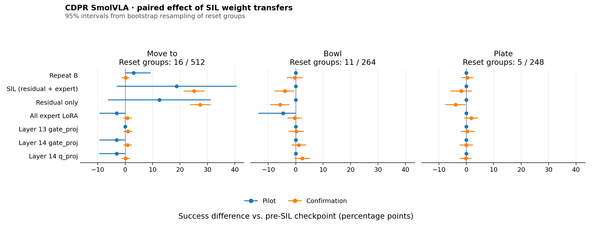
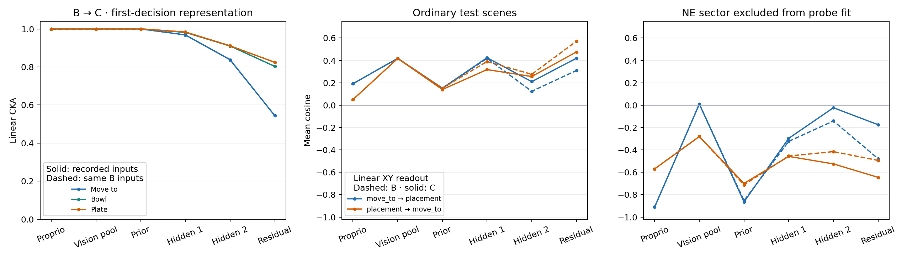
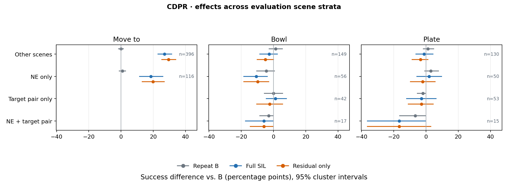
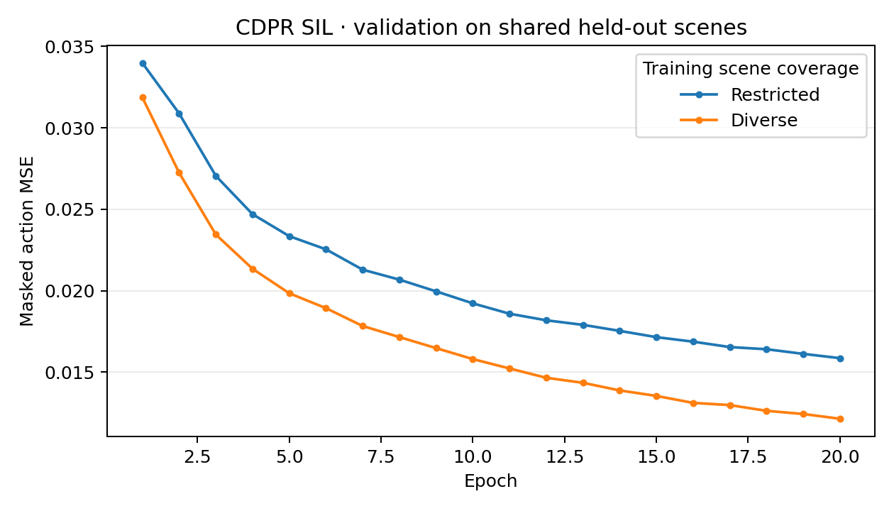

# Забывание и восстановление навыков SmolVLA на CDPR

25 ноября 2026 г.

## Краткое резюме

После retention SIL успех `move_to` в симуляторе CDPR вырос с 9,0% до 34,1%. Перенос одного residual из чекпоинта после SIL воспроизвёл этот выигрыш и достиг 36,3%. Перенос только LoRA эксперта дал 9,8%. По placement в миску политика после SIL достигла 28,2% против 32,2% до SIL. На тарелке оценка разницы менее определённа.

На первом решении наибольший сдвиг представлений произошёл у выхода residual для `move_to`. Один линейный probe читает часть информации о направлении в обоих навыках на обычных тестовых сценах. При исключении северо-восточного сектора из обучения probe перенос на этот сектор ухудшается в обоих направлениях. В отдельном эксперименте фиксированного бюджета более разнообразный банк SIL уменьшил ошибку воспроизведения записанных действий. Перенос этого выигрыша на замкнутое управление предстоит измерить.

## 1. Объект исследования и протокол

Политика CDPR складывает action chunk, предложенный экспертом SmolVLA, и поправку обучаемого residual MLP. Сравниваются B, `step_1504301` до retention SIL, и его прямой потомок C, `sft_retention_e60`. Для повторного анализа забывания A, `step_11009573`, служит точкой до просадки `move_to`. Эффекты ниже относятся к переходу B → C. Ранее принятые чекпоинты WidowX и более поздние линии CDPR перечислены в рабочем инвентаре. [Происхождение чекпоинтов](CDPR_CHECKPOINT_RETENTION.md#какие-файлы-нужны) · [Инвентарь серий](data/SMOLVLA_CHECKPOINT_SERIES_20261123.csv)

Замкнутая оценка охватывает `move_to` к предмету и placement в миску или на тарелку из удержания. Пилот содержит по 16 независимых групп стартов для `move_to` и placement. Подтверждающий прогон содержит по 512 групп на задачу, по два эпизода на группу. Среди placement 264 группы относятся к миске, 248 — к тарелке. Каждая подстановка и исходная политика оцениваются на тех же стартах и горизонтах. Веса LoRA vision tower исключены из всех сравниваемых веток. Интервалы 95% получены парным bootstrap по группам стартов. Пилот и подтверждение используют разные раунды. В графике их оценки сохранены отдельно. [Протокол прогона и контрольные суммы](CDPR_CHECKPOINT_RETENTION.md#подтверждающий-прогон-cdpr-от-23-ноября-2026)

## 2. Вклад компонент политики в восстановление навыка

| Политика | `move_to`, из 1 024 | Миска, из 528 | Тарелка, из 496 |
| --- | ---: | ---: | ---: |
| B до SIL | 92 (9,0%) | 170 (32,2%) | 269 (54,2%) |
| Повтор B | 94 (9,2%) | 168 (31,8%) | 271 (54,6%) |
| C после SIL | **349 (34,1%)** | 149 (28,2%) | 260 (52,4%) |
| Residual из C | **372 (36,3%)** | 140 (26,5%) | 250 (50,4%) |
| Все LoRA эксперта из C | 100 (9,8%) | 168 (31,8%) | 278 (56,0%) |
| `gate_proj` слоя 13 | 102 (10,0%) | 171 (32,4%) | 271 (54,6%) |
| `gate_proj` слоя 14 | 101 (9,9%) | 176 (33,3%) | 269 (54,2%) |
| `q_proj` слоя 14 | 93 (9,1%) | 183 (34,7%) | 268 (54,0%) |

Полная политика C дала для `move_to` **+25,10 п.п.** к B (95% интервал [21,39; 29,00]), а перенос одного residual **+27,34 п.п.** [23,63; 31,15]. Прямой контраст C относительно ветки только с новым residual составил −2,25 п.п. [−4,69; +0,20]. В рамках этих подстановок обновлённый residual достаточен для воспроизведения выигрыша `move_to`. После переноса всех экспертных LoRA без изменения residual выигрыш составил +0,78 п.п. [−0,78; +2,34]. Интервалы одиночных подстановок включают ноль.

Для миски полный C дал −3,98 п.п. [−7,77; −0,57] относительно B. Для тарелки оценка составила −1,81 п.п. [−5,85; +2,02]. Выигрыш в старом навыке сопровождался снижением результата на одной из задач, на которых проверялся placement. Вывод для миски относится к общему для веток cap 0,20 м. [Полная таблица парных эффектов и прямых контрастов](results/cdpr_projection_confirmation_20261123/paired_projection_effects.csv)

**Связь с Ramasesh et al.** Здесь интервенция переносит параметры из C, чтобы локализовать восстановление после SIL. Нижний ряд Fig. 1 статьи проверяет забывание через возврат непрерывных ранних либо поздних блоков из состояния до обучения второму навыку. Прямой аналог в CDPR требует переноса из A в B по 1, 2, 4 и 8 блоков action-expert LoRA и парного сравнения «поздние минус ранние». [Ramasesh et al., Fig. 1](https://arxiv.org/pdf/2007.07400#page=4)

## 3. Изменение представлений и перенос направления

Из сохранённых входов и весов восстановлены активации двух скрытых слоёв residual и его ограниченный выход на первом решении. Максимальная погрешность восстановления первых четырёх команд ниже 1,8×10⁻⁶. CKA (центрированное выравнивание ядер) сравнивает геометрию представлений на сопоставленных стартах. На каждую reset-группу взято одно представление. [Kornblith et al., метод CKA](https://proceedings.mlr.press/v97/kornblith19a.html) · [Численная сверка команд](results/cdpr_projection_confirmation_20261123/integrity.csv)

| Навык | Визуальный пул | Prior | Скрытый слой 1 | Скрытый слой 2 | Выход residual |
| --- | ---: | ---: | ---: | ---: | ---: |
| `move_to` | 1,000 | 1,000 | 0,968 | 0,838 | **0,544** |
| Миска | 1,000 | 1,000 | 0,982 | 0,910 | 0,803 |
| Тарелка | 1,000 | 1,000 | 0,984 | 0,911 | 0,824 |

Сдвиг B → C усиливается к выходу residual и выражен сильнее для `move_to`. При подаче обеим моделям одинаковых входов B профиль практически сохраняется. Это процедурный аналог второго ряда Fig. 1 Ramasesh et al. для **восстановления B → C внутри residual**, со своей архитектурой и другой фазой обучения. [Ramasesh et al., Fig. 1](https://arxiv.org/pdf/2007.07400#page=4) · [Полные значения CKA](results/cdpr_projection_confirmation_20261123/residual_cka.csv)

Линейная регрессия оценивает направление XY к предмету в `move_to` и к ёмкости в placement. После SIL средний cosine на выходе residual для `move_to` → placement составляет 0,420 на обычных тестовых сценах (42 группы), а для placement → `move_to` — 0,476 (75 групп). Визуальный пул даёт около 0,418 в обоих случаях. В исключённом из fit секторе NE cosine residual равен −0,175 и −0,645 соответственно (106 и 116 групп). Значит, доступный линейному probe сигнал чувствителен к раскладке. По этому тесту нельзя установить, что действие причинно опирается на общий код направления. [Ramasesh et al., Appendix H](https://arxiv.org/pdf/2007.07400#page=17) · [CSV readout, контрольных входов и фолдов](results/cdpr_projection_confirmation_20261123/direction_readouts.csv)

## 4. Разнообразие сцен и перенос

При ретроспективной группировке замкнутой оценки выигрыш полного C для `move_to` составил +18,53 п.п. в NE и +27,02 п.п. вне NE. Для миски разница C относительно B в NE без комбинации «апельсин → миска» составила −10,71 п.п. [−18,75; −3,57] на 56 группах. Вне NE и выбранной пары оценка составила −2,68 п.п. [−8,72; +2,68] на 149 группах. Эти разведочные разрезы не оценивают причинный вклад состава обучающих данных. Малые пересечения пары и сектора содержали 17 групп для миски и 15 для тарелки. [Результаты по секторам, парам и их пересечениям](results/cdpr_projection_confirmation_20261123/scene_strata.csv)

### Контролируемое дообучение residual

Обе ветки стартуют с B и обучаются на действиях одного улучшенного учителя. Учитель использует residual C с тем же замороженным экспертом и извлечением признаков, что и B. Эффект проверяется на **добавленных данных SIL**. Оба fit исключают NE, «яблоко → тарелка» и «апельсин → миска». Составы совпадают по совместным квотам инструкции, каталога предмета, дистанции, номера решения и валидной части чанка. На ветку приходится 2 560 решений и 10 159 валидных действий за эпоху, 400 обновлений. Обе ветки используют фиксированный последний шаг и общую валидацию из 6 847 решений с разделением по геометрии сцены.

| Обучающий состав | Сцены в fit | Секторы |
| --- | ---: | --- |
| Ограниченный | 78 | SW |
| Более разнообразный | 214 | SW, NW и SE |

| Seed | MSE, только SW | MSE, SW, NW и SE | Относительное снижение |
| --- | ---: | ---: | ---: |
| 1729 | 0,01586 | 0,01214 | 23,5% |
| 1730 | 0,01586 | 0,01222 | 23,0% |
| 1731 | 0,01597 | 0,01226 | 23,3% |

На одном фиксированном разбиении данных более широкий состав снизил ошибку имитации на **23,0–23,5%** при всех трёх обучающих seed. Повторы меняют порядок обучающих батчей. [CSV проверки по seed](results/cdpr_sil_diversity_pilot_20261125/seed_recheck.csv) · [Разрез ошибок по навыкам и группам для seed 1729](results/cdpr_sil_diversity_pilot_20261125/offline_metrics.csv).

**Связь с Shi et al.** В §III статьи разнообразие меняют при одинаковом объёме данных и оценивают перенос после обучения. Здесь тот же принцип применён к дополнительному SIL residual на общей истории обучения и фиксированном учителе. Стратификация в духе Fig. 5 помогает увидеть разные режимы, а проверка на новых эпизодах нужна, чтобы связать меньшую ошибку имитации с успешностью управления. [Shi et al., §III и Fig. 5](https://arxiv.org/html/2507.06219v2#S3)

## 5. Какие выводы ещё требуют замкнутой оценки

| Вопрос | Минимальная проверка | Нужно ли обучать заново |
| --- | --- | --- |
| Поздние блоки LoRA сильнее влияют на забывание `move_to` | На общих стартах подтвердить просадку A → B и сравнить возвраты равных по размеру блоков из A в B. Считать прямой парный контраст по каждому навыку. | Нет. Нужны существующие чекпоинты и оценка. |
| Большее разнообразие банка SIL даёт больше успешных эпизодов | Оценить B и обе обученные ветки на новых раундах. Сравнить diverse − restricted отдельно на обычных стартах, в NE, на отложенных парах и в их пересечении. | Обе ветки первого теста уже обучены. Осталась оценка. |

Имеющихся данных достаточно для вывода о восстановлении `move_to` в CDPR и о роли residual в используемой паре чекпоинтов. Результаты ограничены симуляцией, одной линией CDPR и placement из удержания. Выводы для WidowX, для захвата с нуля и для глубины action expert требуют отдельных оценок. [Команды для двух оставшихся проверок](CDPR_CHECKPOINT_RETENTION.md#причинные-эксперименты-от-25-ноября-2026)
